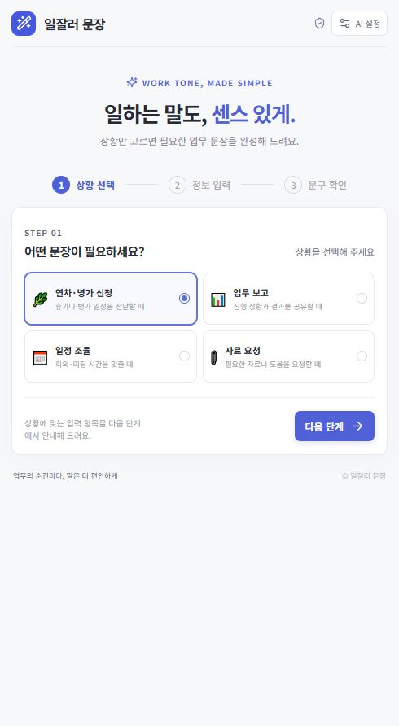
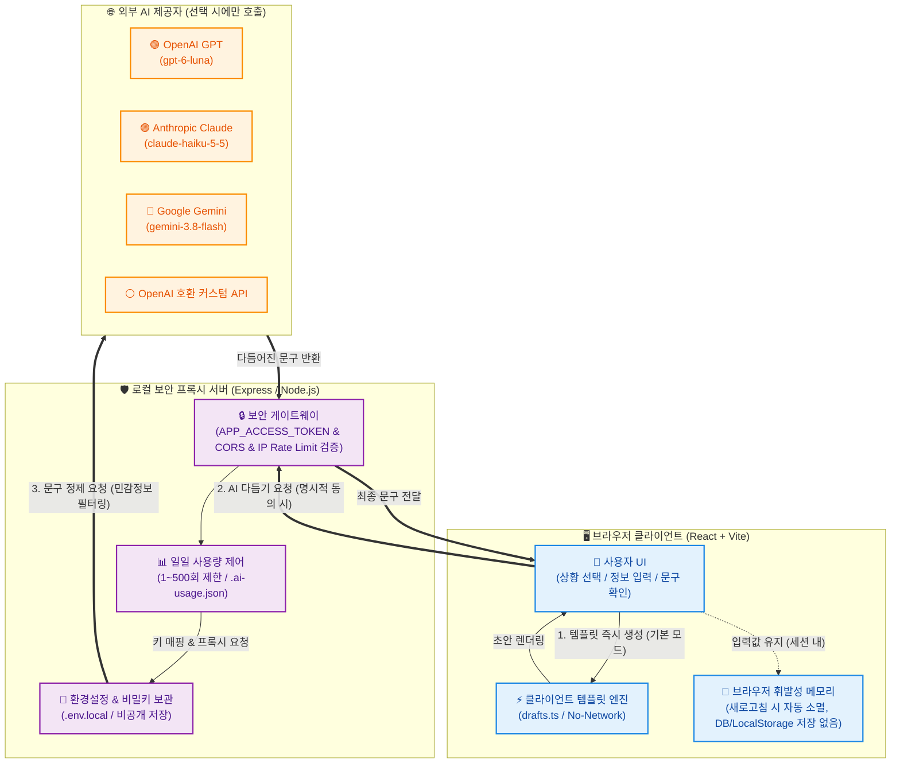
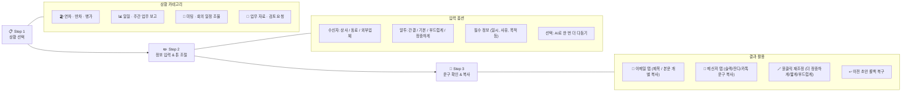
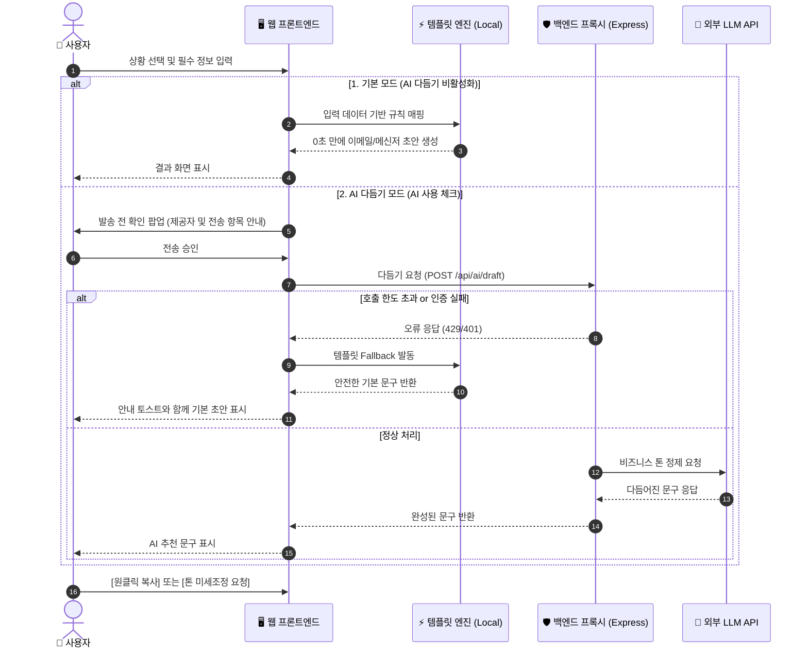

# 💼 일잘러 문장 (WorkTone)

<div align="center">

**한국 직장인을 위한 스마트 비즈니스 문구 작성 솔루션**  
상황과 수신자만 고르면 이메일과 사내 메신저 문구를 0초 만에 완성합니다.  
로그인과 데이터베이스가 필요 없는 **Zero-Retention (개인정보 무보관)** 기반의 안전한 업무 비서입니다.

<br/>

[](https://react.dev/)
[](https://www.typescriptlang.org/)
[](https://vitejs.dev/)
[](https://expressjs.com/)
[](#-보안--개인정보-보호-원칙)
[](#)

<br/>

[✨ 핵심 기능](#-핵심-기능-인포그래픽) •
[🗺️ 시스템 구조](#-시스템-아키텍처--데이터-흐름) •
[🔄 사용 워크플로우](#-3단계-ux-사용-흐름) •
[🚀 빠른 시작](#-빠른-시작-quick-start) •
[🤖 AI 제공자 연동](#-ai-제공자-설정) •
[🛡️ 보안 및 배포 가이드](#-보안--배포-점검-체크리스트)

</div>

---

## 📸 화면 미리보기

GPT 브라우저 및 로컬 환경에서 실행되는 실제 첫 화면입니다. 직관적인 카드형 UI로 누구나 즉시 작성할 수 있습니다.

<div align="center">
  
</div>

---

## 📊 핵심 기능 인포그래픽

| 구분 | 주요 특징 | 상세 설명 | 기대 효과 |
| :---: | :--- | :--- | :--- |
| **⚡ 0초 즉시 생성** | **로컬 템플릿 엔진** | API 키나 외부 서버 없이도 정교한 알고리즘으로 즉시 초안 작성 | 대기 시간 제로, 비용 발생 없음 |
| **🤖 하이브리드 AI** | **선택형 LLM 다듬기** | GPT, Claude, Gemini 및 OpenAI 호환 커스텀 모델 연동 지원 | 상황에 맞는 고품질 문장 리라이팅 |
| **👥 맞춤형 수신자/톤** | **4단계 톤 앤 매너** | 상사 · 동료 · 외부 업체별 말투 및 정중함 수준(간결/기본/부드럽게/매우 정중) | 비즈니스 매너 실수 원천 방지 |
| **📬 듀얼 채널 최적화** | **이메일 & 메신저** | 이메일(제목/본문 분리)과 업무 메신저(슬랙, 잔디, 카카오톡) 맞춤 생성 | 채널별 복사-붙여넣기 편의성 극대화 |
| **🛡️ Zero-Retention** | **개인정보 완벽 보호** | 브라우저 로컬 저장소 및 서버 DB에 입력값 보관 일체 없음 | 기업 내 민감 정보 유출 방지 |

---

## 🗺️ 시스템 아키텍처 & 데이터 흐름

이 프로젝트는 **프라이버시 우선(Privacy-First)** 구조로 설계되어 있습니다. 기본 템플릿 엔진은 브라우저 내부에서 100% 동작하며, AI 다듬기 기능을 선택한 경우에만 로컬 프록시 서버를 통해 최소한의 검증된 데이터만 외부 LLM으로 안전하게 전달됩니다.



---

## 🔄 3단계 UX 사용 흐름

복잡한 설정 없이 3단계만 거치면 실무에 바로 사용할 수 있는 문구가 완성됩니다.



---

## ⚙️ 하이브리드 생성 시퀀스

사용자가 문구를 요청했을 때 동작하는 순서도입니다. AI 서버 장애 시에도 기본 템플릿으로 자동 Fallback되어 업무가 중단되지 않습니다.



---

## 🚀 빠른 시작 (Quick Start)

### 사전 요구 사항
- **Node.js**: v20.0.0 이상
- **npm**: v10.0.0 이상

### 1. 설치 및 프론트엔드 실행
기본 템플릿 기능은 프론트엔드만 실행해도 **즉시 100% 사용 가능**합니다.

```bash
# 의존성 설치
npm install

# 프론트엔드 개발 서버 시작 (기본 포트: 5173)
npm run dev
```
> 브라우저에서 `http://127.0.0.1:5173`으로 접속합니다. (로컬 단독 접속 허용)

### 2. AI 다듬기 서버 실행 (선택 사항)
LLM을 통한 문구 고도화가 필요한 경우, 새 터미널 창을 열고 API 서버를 실행합니다.

```bash
# AI 보안 프록시 서버 실행 (기본 포트: 3001)
npm run server
```

---

## 🤖 AI 제공자 설정

우측 상단 **[AI 설정]** 모달에서 원하는 AI 엔진을 연동할 수 있습니다.

| AI 제공자 | 기본 엔드포인트 URL | 기본 권장 모델 | 특징 |
| :--- | :--- | :--- | :--- |
| **OpenAI (GPT)** | `https://api.openai.com/v1/chat/completions` | `gpt-6-luna` | 가장 대중적이며 표준적인 업무 문체 |
| **Anthropic (Claude)** | `https://api.anthropic.com/v1/messages` | `claude-haiku-5-5` | 자연스럽고 맥락을 살린 부드러운 표현 |
| **Google Gemini** | `https://generativelanguage.googleapis.com/v1beta` | `gemini-3.8-flash` | 빠른 응답 속도와 정확한 정보 전달 |
| **커스텀 API** | 사용자 직접 입력 (`/chat/completions` 필수) | 사용자 지정 | 사내 구축형 모델 또는 vLLM/Ollama 호환 엔드포인트 |

> [!NOTE]
> 커스텀 API는 OpenAI 호환 Chat Completions 규격을 따라야 하며 엔드포인트가 `/chat/completions`로 끝나야 합니다.

### 설정 및 검증 3단계
1. **제공자 및 모델 선택**: API Key를 입력하고 원하는 엔진을 지정합니다.
2. **연결 테스트 (`Test Connection`)**: 외부 제공자로 짧은 핑을 전송하여 키 유효성을 확인합니다. (일일 호출 한도 1회 차감)
3. **설정 저장**: 설정이 성공하면 로컬 `.env.local` 파일에만 안전하게 기록됩니다. 언제든지 **[키 삭제]** 버튼으로 초기화할 수 있습니다.

---

## 🛡️ 보안 & 배포 점검 체크리스트

### 핵심 보안 아키텍처

```
[ 브라우저 ]  ──(메모리 유지 / No LocalStorage)──
     │
     ▼
[ 프록시 서버 ] ──(127.0.0.1 로컬 바인딩 / 외부 노출 차단)──
     │
     ▼
[ .env.local ]  ──(Git 커밋 제외 / 서버 계정 로컬에만 보관)──
```

> [!IMPORTANT]
> **Zero-Retention 원칙**: 본 애플리케이션은 사용자가 입력한 업무 내용, 일정, 사유를 브라우저의 `localStorage`, `IndexedDB` 또는 서버 데이터베이스에 영구 보관하지 않습니다.

### 📋 안전한 운영 및 배포 체크리스트

- [ ] **로컬 인터페이스 바인딩**: AI 프록시 서버는 기본적으로 `127.0.0.1`에 바인딩되어 외부 임의 접근을 차단합니다.
- [ ] **비밀키 파일 보호**: `.env.local` 파일은 `.gitignore`에 등록되어 커밋되지 않습니다. 절대 외부에 공유하거나 공용 레포지토리에 올리지 마세요.
- [ ] **출처 검증 (CORS)**: 외부 배포 시 `FRONTEND_ORIGIN`에 프론트엔드의 정확한 도메인을 지정하세요.
- [ ] **접근 토큰 설정**: 외부 노출이 필요한 경우 32자 이상의 임의 `APP_ACCESS_TOKEN`을 설정하고 사용자에게 안전하게 전달하세요. (앱 화면에서 요구되며 브라우저 메모리에만 유지)
- [ ] **호출 상한 및 비용 방어**:
  - 일일 호출 상한(1~500회)이 `.ai-usage.json` 파일에 날짜별(KST)로 기록됩니다.
  - IP별 분당 요청 제한(Rate Limit)이 기본 적용됩니다.
- [ ] **HTTPS 리버스 프록시**: 프로덕션 배포 시 Nginx/Caddy 등의 리버스 프록시 뒤에 배치하고 HTTPS를 강제하세요.
- [ ] **무로그 원칙**: 서버 로그에 민감한 사용자 입력 본문이나 API 키가 남지 않도록 설계되어 있습니다.

---

## 🧪 테스트 및 프로덕션 빌드

자동화 테스트를 통해 템플릿 생성 로직과 수신자별 문체 분기 규칙의 무결성을 검증합니다.

```bash
# 단위 테스트 실행 (템플릿 및 수신자별 표현 검증)
npm test

# 프로덕션 빌드 (TypeScript 컴파일 & Vite 번들링)
npm run build

# 프로덕션 빌드 미리보기
npm run preview
```

---

<div align="center">

Made with ❤️ for Korean Professionals  
업무 효율을 극대화하고 이메일 스트레스를 줄여보세요!

</div>
